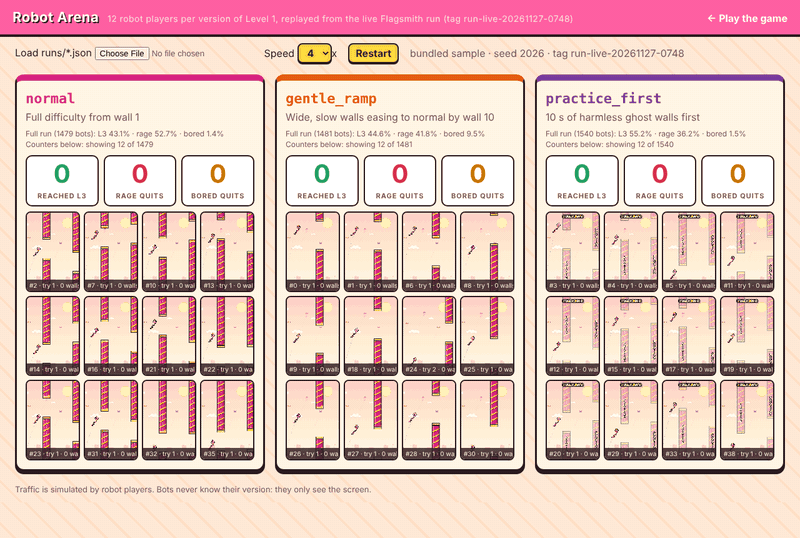
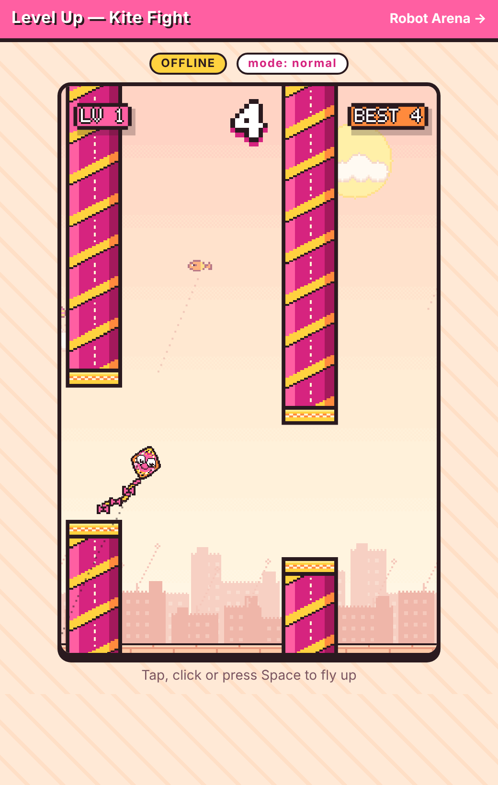
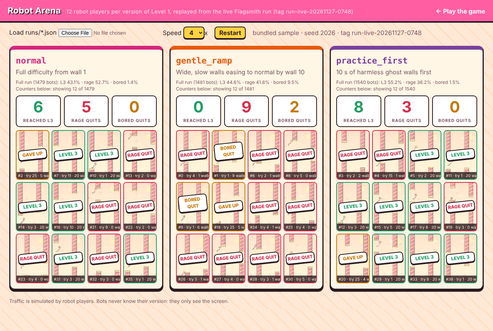
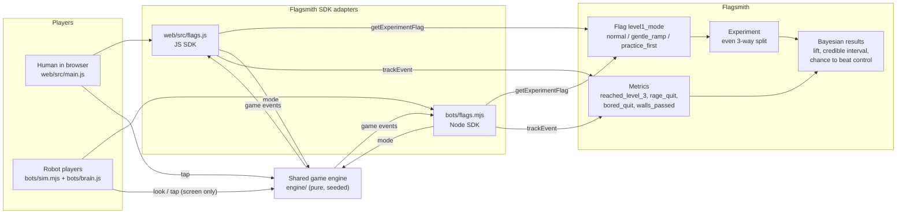

# Level Up

**We A/B test the first level of a tiny browser game with Flagsmith Experimentation. Robot players who don't know which version they're in showed us our first guess was wrong, before a single real player had to suffer it.**

Toggle Wars (WeMakeDevs × Flagsmith) · Track 01: Test Something Real



*Robot Arena: replay of the first 12 robots per version from the live Flagsmith run; full-run rates in each lane header.*

**Play it online:** `<TODO: https://<your-user>.github.io/<repo>/>` (add `arena.html` for the Robot Arena)
**Demo video:** `<TODO: video link>` · **Pre-registration:** [docs/HYPOTHESIS.md](docs/HYPOTHESIS.md) · **Design:** [docs/DESIGN.md](docs/DESIGN.md) · **Code walkthrough:** [docs/WALKTHROUGH.md](docs/WALKTHROUGH.md)

> **Traffic is simulated by robot players.** Every bot is a real Flagsmith identity, assigned by Flagsmith, sending real events to Flagsmith. The bots do not know which version they are playing, and a test proves it. [Is the traffic real?](#is-the-traffic-real)

---

## The story in 20 seconds

1. Most new players leave a game almost at once. Should the first level be easier?
2. We put three versions of the first try behind one Flagsmith flag.
3. Our first guess (v1): an easier start, `gentle_ramp`, keeps more players.
4. Our offline pre-flight with 4,500 robot players said **no**. `gentle_ramp` barely helped and bored skilled players. A 10-second practice zone, `practice_first`, did better and looked safe.
5. We kept v1 as written, logged every change, froze v2 in git, and ran **one** live Flagsmith experiment with fresh identities. That run is the official result.

## See it

| The game (`?debug` shows your version) | The Robot Arena |
| --- | --- |
|  |  |

The screenshots are from the offline build (no Flagsmith key), so everyone plays `normal` and the yellow **OFFLINE** badge shows. With a client key, the badge goes away and `?debug` shows the version Flagsmith picked.

Both pages are a static site: GitHub Pages hosts them for free (see `.github/workflows/pages.yml`).

## The experiment at a glance

| | |
| --- | --- |
| **Question** | What first try keeps more new players going until Level 3, without boring skilled players? |
| **Hypothesis (v2, primary)** | `practice_first` will increase the share of players who reach Level 3 versus `normal` by at least 10% relative, without raising bored quits by more than 2 points and without raising rage quits. |
| **Guardrail prediction (v2)** | `gentle_ramp` will fail the bored-quit guardrail (more than +2 points). |
| **v1 (kept, superseded)** | "An easier start (`gentle_ramp`) will increase the share of new players who reach Level 3 by at least 15%…" See [why it changed](docs/HYPOTHESIS.md#part-2-change-log). |
| **Flag** | `level1_mode` (multivariate) |
| **Variants** | `normal` (control): full difficulty · `gentle_ramp`: wider, slower walls easing to normal by wall 10 · `practice_first`: 10 s of harmless ghost walls, then normal. **Variants change the first try only**; every retry is normal. |
| **Goal metric** | `reached_level_3` (occurrence, higher is better) |
| **Guardrails** | `rage_quit`, `bored_quit` (occurrence, lower is better) |
| **Secondary** | `walls_passed` (mean of the best try, higher is better) |
| **Traffic** | 4,500 robot players (about 1,500 per arm), 100% enrolled, even three-way split, one live run |
| **Decision rule** (written first) | Ship a variant only if: the split check passes and nothing says "Collecting data"; its chance to beat control on `reached_level_3` is above 95%; bored quits rise by no more than 2 points; and rage quits are not worse. Otherwise keep `normal`. |

## How we use Flagsmith

Flagsmith decides what every player sees, records who saw what, and gives the official result.

1. **A multivariate flag builds the first try.** `level1_mode` has a control value (`normal`) and two keyed variants (`gentle_ramp`, `practice_first`). The engine reads the mode and builds the first try from it.
2. **An experiment splits the players.** A Flagsmith experiment on `level1_mode` enrols 100% of identities and splits them evenly. Bucketing is deterministic on the identity, so a player always gets the same version.
3. **Exposure is recorded at the right moment.** `getExperimentFlag('level1_mode', id)` returns the version and records that this identity saw it, just before it plays.
4. **Metrics come from real events.** Robot players send all four events with `trackEvent`. The browser game sends `reached_level_3` and `walls_passed`; rage and bored quits are measured for robots only. Event names live in one file, `engine/constants.js`.
5. **Flagsmith's Bayesian engine gives the official result.** It shows lift, the 95% credible interval and the chance to beat control. Our simulator adds a split check (chi-square) and a local sanity check (z-test). Those catch pipeline problems; they don't replace Flagsmith's verdict.
6. **The same flag ships the winner.** Ending the experiment with "roll out a variant" makes Flagsmith serve the winner to everyone. No redeploy. Open the game with `?debug` to see which version you got.

The three calls that matter (Node, used by the robots):

```js
const flag = await flagsmith.getExperimentFlag('level1_mode', botId); // version + exposure
flagsmith.trackEvent('reached_level_3', { identifier: botId });       // a metric event
await flagsmith.close();                                               // send what's left
```

The browser uses the same pattern with the JavaScript SDK: `identify`, `getExperimentFlag`, `trackEvent`, `flushEvents`.

Click-by-click setup, the A/A environment and the rollout steps are in [docs/FLAGSMITH_SETUP.md](docs/FLAGSMITH_SETUP.md).

## Architecture



## Results

### Offline dry run, seed 42 (pre-flight, not the official result)

`npm run sim:dry`: 4,500 bots, no network. Arms are assigned by a local hash, not by Flagsmith.

| Arm | Bots | Reached Level 3 | Rage quit | Bored quit | Mean walls (best try) |
| --- | --- | --- | --- | --- | --- |
| `normal` | 1,510 | 45.3% | 49.9% | 1.5% | 10.5 |
| `gentle_ramp` | 1,544 | 44.0% (−1.3 pts, −3%) | 42.5% | 8.5% (+7.0 pts) | 11.0 |
| `practice_first` | 1,446 | 53.1% (+7.8 pts, +17%) | 37.6% | 1.8% (+0.3 pts) | 12.9 |

- Bored quits among skilled bots (`aimNoise` < 10 px): `normal` 5.0%, `gentle_ramp` **27.8%**, `practice_first` 6.9%.
- Local sanity check: `practice_first` z = 4.25. `gentle_ramp` z = −0.73.
- Split check: PASS (chi² = 3.30, p = 0.19).
- Seeds 1 and 7 and the A/A and sensitivity runs are summarised in [HYPOTHESIS.md](docs/HYPOTHESIS.md#what-the-dry-runs-showed-offline-not-the-official-result).

### Live Flagsmith results (official)

One live run on 27 Nov 2026: 4,500 fresh robot identities (`--seed 2026`), Flagsmith Cloud, experiment "Level 1 difficulty". Results as of 2026-11-27 13:12 UTC. Evidence: [`docs/results/`](docs/results/) (`results-final.json`, `exposures-final.json`, `experiment-final.json`).

**Health:** A/A check passed (no winner; [results-aa.json](docs/results/results-aa.json)) · Split check PASS (chi² = 1.60, p = 0.449) · Fallbacks 0 · Exposures per arm 1,479 / 1,481 / 1,540 · Flagsmith SRM: not computed in this set-up, so we rely on our split check.

| Metric | Variant | Rate / mean | Lift vs `normal` | 95% credible interval | Chance to beat control | Verdict |
| --- | --- | --- | --- | --- | --- | --- |
| `reached_level_3` | `normal` | 43.1% | | | | control |
| `reached_level_3` | `practice_first` | **55.2%** | **+28.0%** | [+18.5%, +37.4%] | **> 99.9%** | beats control |
| `reached_level_3` | `gentle_ramp` | 44.6% | +3.5% | [−5.0%, +11.9%] | 79.0% | inconclusive |
| `bored_quit` | `practice_first` | 1.5% (+0.1 pts) | +10.4% | [−55.3%, +76.2%] | 37.8%\* | passes (≤ 2 pts) |
| `bored_quit` | `gentle_ramp` | 9.5% (**+8.1 pts**) | +599% | [+275%, +923%] | < 0.1%\* | **fails guardrail** |
| `rage_quit` | `practice_first` | 36.2% (−16.6 pts) | −31.4% | [−37.0%, −25.8%] | > 99.9%\* | passes |
| `rage_quit` | `gentle_ramp` | 41.8% (−10.9 pts) | −20.7% | [−26.9%, −14.6%] | > 99.9%\* | passes |
| `walls_passed` | `practice_first` | 13.15 (normal 10.02) | +31.3% | [+23.8%, +38.7%] | > 99.9% | beats control |
| `walls_passed` | `gentle_ramp` | 11.18 | +11.6% | [+4.8%, +18.4%] | > 99.9% | beats control |

\* For `rage_quit` and `bored_quit`, lower is better: "chance to beat control" is the chance the variant is lower.

Bored quits among skilled robots (`aimNoise` < 10 px): `normal` 5.3%, `practice_first` 5.5%, `gentle_ramp` **30.2%**.

**Decision:** Ship `practice_first`. It clears every line of the v2 rule written before the run: > 95% chance to beat control on `reached_level_3`, bored quits up only 0.1 points, rage quits down, split check passed.
**H1** (practice_first, at least +10%): **confirmed** (+28.0%, whole interval above +10%). **H2** (gentle_ramp fails the bored-quit guardrail): **confirmed** (+8.1 points against a 2-point limit).
**Next test:** an adaptive first try — practice zone for players who crash early, skipped for players who clear the first walls cleanly.

## Is the traffic real?

The players are simulated. The experiment is not.

- **Real Flagsmith identities.** Each bot is an identity `bot-<tag>-<n>`, assigned by Flagsmith's own bucketing. Live tags carry a timestamp, and the simulator refuses to reuse one, so every live run uses fresh identities.
- **Real events, real stats.** Flagsmith's engine computes the official results.
- **Bots don't know their variant.** The brain gets only a "screen": `look()` (height, speed, next gap, score) and `tap()`. A unit test wraps the game in a Proxy that throws if the brain reads `mode`, `runIndex` or `ghost`.
- **Traits don't depend on the variant.** Reaction time, aim, patience and boredom limit come from the seed and the bot number, before assignment.
- **Feelings come from play.** Rage = too many fast crashes in a row. Boredom = walls that felt easy *for that bot's skill*.
- **Replayable.** Seeds are fixed and every run is saved to `runs/<tag>.json`. The Arena replays them.
- **A/A check.** Every arm plays `normal`, in a separate Flagsmith environment. Differences stayed within ±3.1 points offline.
- **Robustness.** `npm run sim:dry -- --sensitivity` reruns with more-skilled and less-patient populations.

What bots can't tell you is how real people feel. That and other limits are listed in [HYPOTHESIS.md](docs/HYPOTHESIS.md#known-limitations-current). A studio would keep the flag, events and experiment, swap the robots for real players, and keep the robots as a pre-flight check.

## Quick start

Requires Node 20+.

```bash
git clone <repo-url> && cd levelup
npm install

npm test                          # engine, brain-honesty and adapter tests
npm run sim:dry -- --sample       # offline: 4,500 robot players + Arena sample; no account needed
npm run dev                       # play the game; open /arena.html for the Robot Arena
                                  # add ?debug to the game URL to see your version
```

More offline runs:

```bash
npm run sim:dry -- --seed 1       # another seed
npm run sim:dry -- --aa           # A/A: every arm plays normal
npm run sim:dry -- --sensitivity  # baseline vs more-skilled vs less-patient players
```

Connect Flagsmith (see [docs/FLAGSMITH_SETUP.md](docs/FLAGSMITH_SETUP.md) first):

```bash
cp .env.example .env              # fill in the keys; .env is git-ignored
node scripts/check-flagsmith.mjs  # read-only connection check
npm run sim -- --aa --bots 1500   # A/A check, separate environment
npm run sim -- --bots 4500 --seed <v2 seed>   # the ONE live run
```

The server keys are only used by the robots on your machine. The browser uses the public client-side key.

## Project structure

```
levelup/
  package.json          scripts: dev, build, preview, sim, sim:dry, test
  engine/               the game: pure logic, no DOM, deterministic given a seed
    constants.js        flag name, modes, event names, level sizes
    config.js           how each mode shapes the first try (gap, speed, ghost)
    game.js             create, step, level, observe, makeScreen
    rng.js              seeded random numbers
  bots/
    brain.js            robot traits, when to flap, rage and boredom
    flags.mjs           Flagsmith Node adapter + offline dry-run adapter
    sim.mjs             runs the robots, sends events, prints checks, saves runs/<tag>.json
  web/
    index.html, src/main.js     the game for humans (?debug shows your version)
    arena.html, src/arena.js    12 robots per version, replayed side by side
    src/flags.js                Flagsmith browser adapter
    src/draw.js, src/style.css  drawing and styles
  scripts/              check-flagsmith.mjs (read-only check), run-tests.mjs
  test/                 engine, brain and adapter tests
  docs/                 DESIGN, HYPOTHESIS, FLAGSMITH_SETUP, PITCH, VIDEO_SCRIPT, WALKTHROUGH,
                        EVENING_CHECKLIST, media/ (GIF + screenshots), results/
  .github/workflows/    ci.yml (tests + smoke run on every push), pages.yml (free hosting)
  .env.example          key names only
```

## Docs

- [DESIGN.md](docs/DESIGN.md): what we built and why
- [HYPOTHESIS.md](docs/HYPOTHESIS.md): v1, change log, v2, decision rule, power, limitations
- [FLAGSMITH_SETUP.md](docs/FLAGSMITH_SETUP.md): flag, metrics, A/A environment, experiment, rollout
- [WALKTHROUGH.md](docs/WALKTHROUGH.md): every file explained in plain English
- [PITCH.md](docs/PITCH.md): the story, with answers to likely questions
- [VIDEO_SCRIPT.md](docs/VIDEO_SCRIPT.md): the demo video, shot by shot
- [EVENING_CHECKLIST.md](docs/EVENING_CHECKLIST.md): tonight's steps, from empty GitHub repo to submitted

## Team

Team: Garima Patel

## License

[MIT](LICENSE)

---

## Before submitting (TODO)

Step-by-step version with exact commands: [docs/EVENING_CHECKLIST.md](docs/EVENING_CHECKLIST.md).

- [ ] v2 of `docs/HYPOTHESIS.md` committed and pushed **before** the live run; fill in the commit hash and date in its change log
- [ ] A/A check done; evidence in `docs/results/` (`results-aa.json`, screenshot)
- [ ] One live run done; evidence in `docs/results/` (`results-final.json`, `exposures-final.json`, screenshots)
- [ ] "Live Flagsmith results" table and decision filled in above
- [ ] Results screenshot added: `docs/results/results.png`, then linked here
- [x] Arena GIF and screenshots in `docs/media/` and embedded above (re-record after the live run if you want the live run in the Arena)
- [ ] GitHub Pages turned on (one time): repo **Settings → Pages → Source: GitHub Actions**. Then push to `main` (or run "Deploy to GitHub Pages" from the **Actions** tab). The site appears at `https://<your-user>.github.io/<repo>/`; put that link in "Play it" at the top
- [ ] (Optional) Flagsmith in the hosted game: **Settings → Secrets and variables → Actions → Variables → New variable** `VITE_FLAGSMITH_CLIENT_KEY` = the *client-side* key, then re-run the Pages workflow. Add it only **after** the live experiment has ended, so visitors don't become players in the official run. Never use the server key (`ser.…`)
- [ ] CI is green: the **Actions** tab shows a tick for the latest commit
- [ ] Demo video link added at the top
- [ ] Team names filled in here and in `LICENSE` (README done)
- [ ] `npm test` passes on a fresh clone; `.env` not committed (`git status`)
